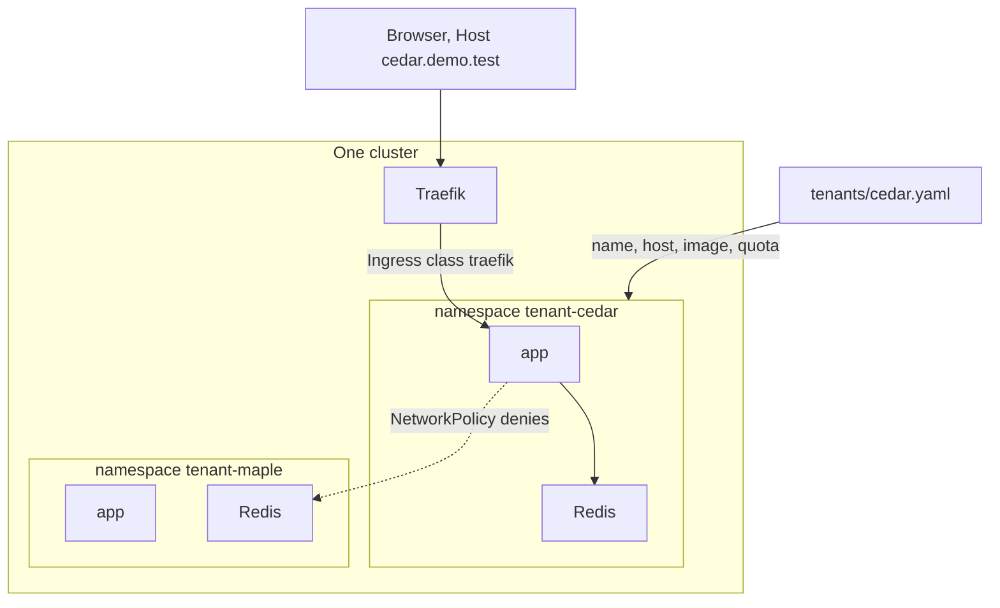

# platform-tenants

A team gets a tenant on a shared cluster by committing one file. That file sets a name, a host, an image, and a quota. It cannot change the cluster, and it cannot reach a neighbor.

The tenant names here are invented. This is not an employer's platform, and the tree has no account identifiers. Measurement and error budgets live in [sli-slo-baseline](https://github.com/hmerkieiev/sli-slo-baseline). This repository does not page on burn.

## The picture

One cluster. Traefik is the only public entry. Each file in `tenants/` becomes one namespace. Inside it: the app and its Redis. The app answers `<tenant> <version>`, for example `cedar 1.0.0`. The version is baked into the image, so a new tag is a new release.



Redis has no password. The NetworkPolicy is the wall: a pod may talk to pods in its own namespace and may make DNS queries. The app port accepts traffic only from the `traefik` namespace. A pod in `tenant-cedar` cannot open Redis in `tenant-maple`.

## The file

```yaml
name: cedar
host: cedar.demo.test
image: platform-tenants-app:1.0.0
quota:
  pods: "4"
  cpu: 500m
  memory: 256Mi
```

`charts/tenant` renders, and only this, from those four fields:

- namespace `tenant-<name>`
- a resource quota and a limit range
- a default-deny NetworkPolicy, plus the three allows above
- Redis
- the app
- an Ingress on class `traefik`

Traefik, the CNI, and the VPC are installed by the platform. A tenant file that carries any other key is rejected, so it cannot set a CNI or a VPC CIDR. The rendered chart is rejected when it contains a ClusterRole or any namespace other than its own.

`scripts/platform tenant create` writes only that file:

```sh
scripts/platform tenant create birch \
  --host birch.demo.test \
  --image platform-tenants-app:1.0.0 \
  --pods 4 --cpu 500m --memory 256Mi
```

`gitops/project.yaml` is the same rule for Argo CD: a tenant Application may create a Namespace, and no other cluster-scoped kind. `gitops/applicationset.yaml` turns one file into one Application. The local demo applies the chart itself, so it can run before this repository has a remote.

## Rules the check enforces

- The image tag `latest` is not a release.
- Quota stays inside 2–10 pods, 200m–2000m CPU, and 128Mi–1024Mi memory. The floor exists because the tenant runs an app and Redis.
- The host is under `demo.test`.
- The name `internal` is reserved, and namespaces are prefixed with `tenant-`. A namespace named `internal` would make `redis-sessions.internal` a cluster-wide name and steal every tenant's Redis. The fixed Redis name is `redis-sessions.internal`: pod hostname `redis-sessions`, headless Service `internal`. Tenant pods use `dnsPolicy: ClusterFirst` and `ndots` of 2. At `ndots` 1 a name that already contains a dot is looked up as a final name and misses the search path.

## Run

Docker, kubectl, Helm, and Python 3. `scripts/demo` downloads kind if it is missing. The first run pulls Calico, Traefik, and the Redis image.

```sh
scripts/demo
scripts/demo down
```

The script restores your previous kubectl context. While the cluster is up:

```sh
curl -H 'Host: cedar.demo.test' http://127.0.0.1:8090/
kubectl --context kind-platform-tenants get ns
```

Green means both of these held:

1. `birch` appeared from one new file, answered on `birch.demo.test`, and could not open cedar's Redis. Cedar was unchanged.
2. Cedar's image moved to `1.1.0`. Maple and birch stayed on `1.0.0`. The Traefik and Calico images stayed put.

`scripts/platform check` is the same contract without a cluster.

## On an account

Two Terraform roots replace the kind bootstrap. `terraform/cluster` is the network, the cluster, and Traefik. `terraform/tenant` opens one namespace and records the host, the image, and the quota. `terraform/tenant/isolated` is a separate state that only installs `charts/tenant` into that namespace. A second tenant is a second state of those two roots, not a second cluster. See [docs/aws.md](docs/aws.md).

## License

[MIT](LICENSE)
